## GLOG Workshop 2026 {.cover .center}

[Global Log Project]{.subtitle}

[November 17th, 2026]{.date}

[Instituto Superior Técnico &middot; Lisbon, Portugal]{.title-location}

::: {.title-sponsors}
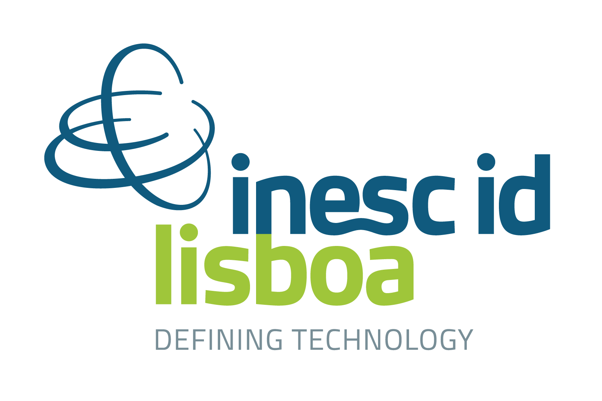
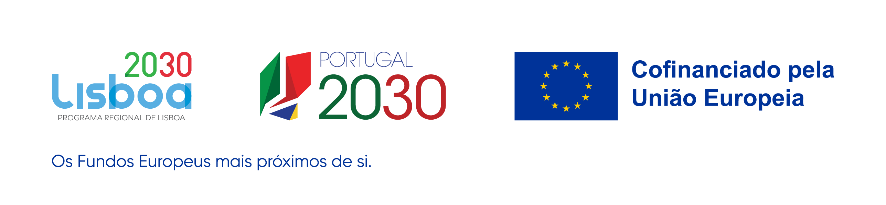
:::

## Distinguished Lecture

::: {.lecture .lecture-big}
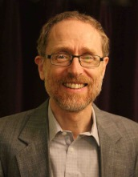

::: {}
[Distinguished Lecture]{.lecture-label}

### Chain Replication Revisited {.lecture-title}

[Robbert van Renesse]{.lecture-speaker}

[Cornell University &middot; 12:00 &ndash; 13:00 &middot; Anfiteatro Abreu Faro]{.lecture-meta}
:::
:::

## Invited Speakers

::: {.invited}
::: {.lecture}
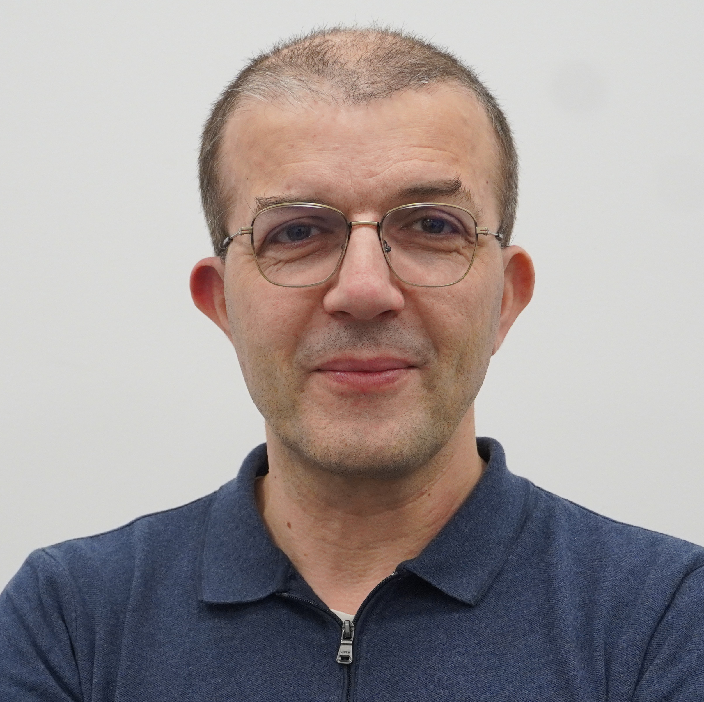

[Invited Talk]{.lecture-label}

[José Orlando Pereira]{.lecture-speaker}

[Universidade do Minho &middot; 14:30]{.lecture-meta}
:::

::: {.lecture}
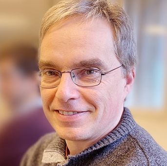

[Invited Talk]{.lecture-label}

[Nuno Preguiça]{.lecture-speaker}

[Universidade NOVA de Lisboa &middot; 16:30]{.lecture-meta}
:::
:::

## Speakers

::: {.speakers}
::: {}

[João Verissimo]{.speaker-name}
[NDSS'27]{.speaker-venue}
:::

::: {}
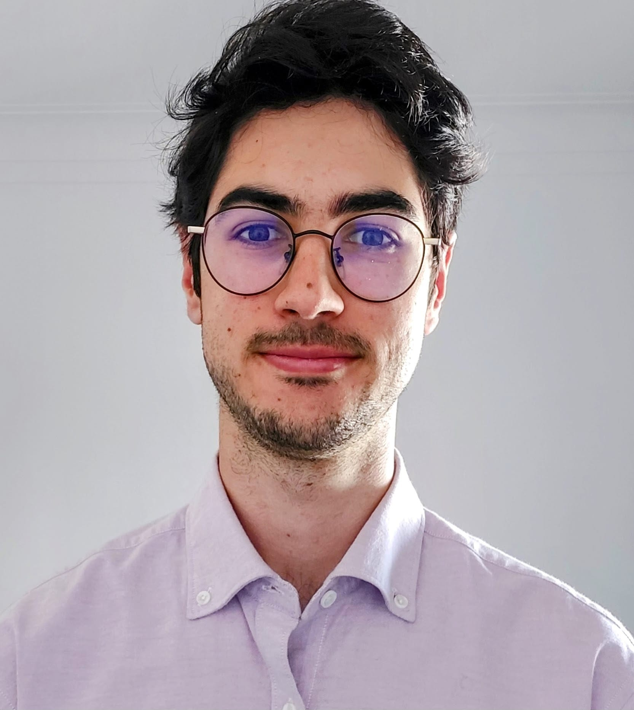
[Bernardo Ribeiro]{.speaker-name}
[ASPLOS'26]{.speaker-venue}
:::

::: {}
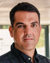
[João Garcia]{.speaker-name}
[OSDI'26]{.speaker-venue}
:::

::: {}
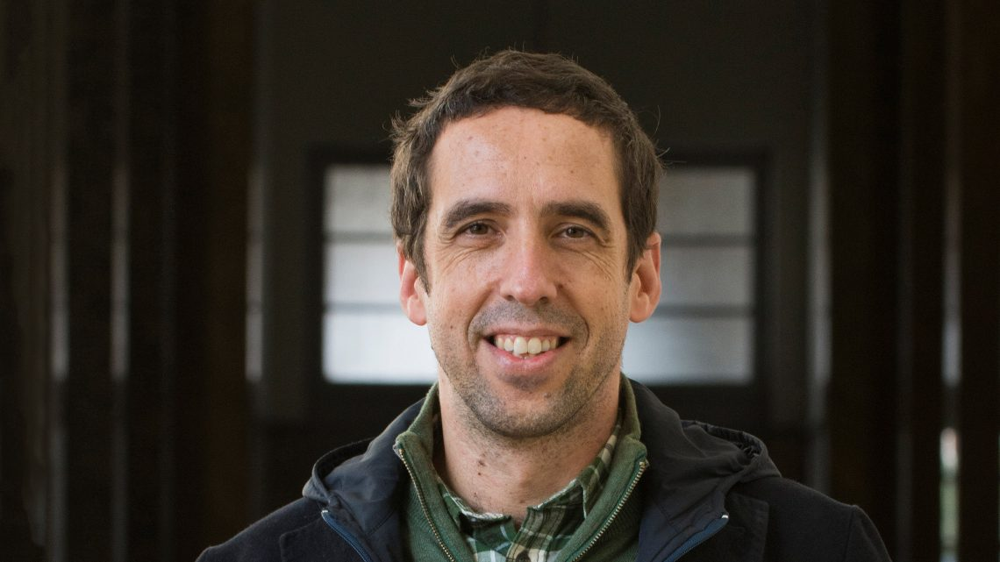
[Rodrigo Rodrigues]{.speaker-name}
:::

::: {}
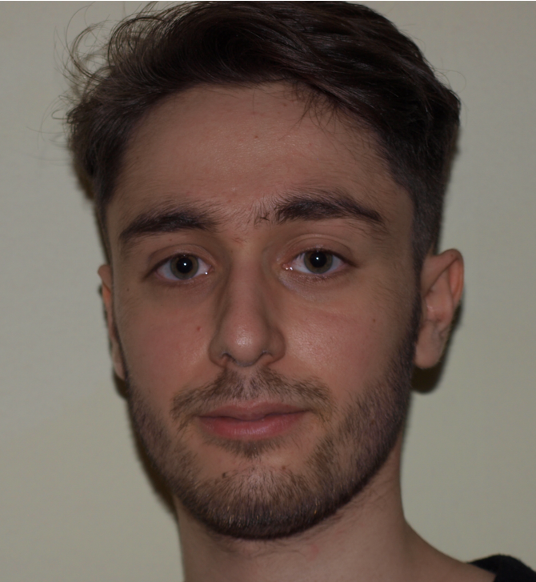
[Sebastião Amaro]{.speaker-name}
[EuroSys'26]{.speaker-venue}
:::

::: {}
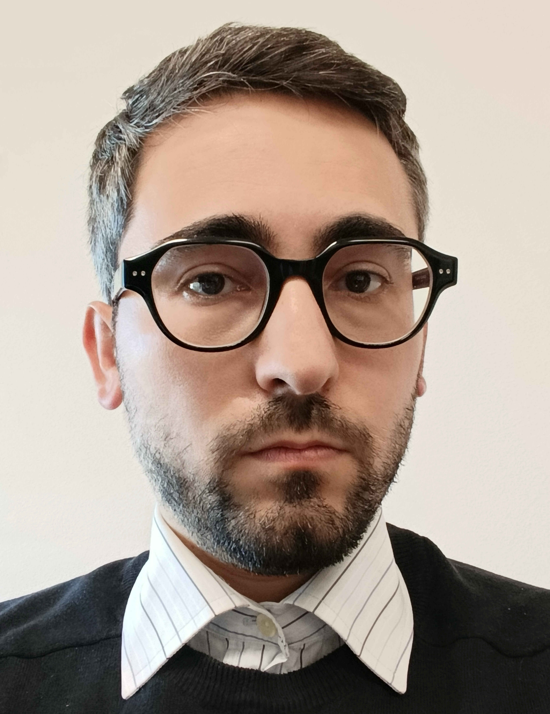
[Daniel Castro]{.speaker-name}
[EuroSys'26]{.speaker-venue}
:::

::: {}
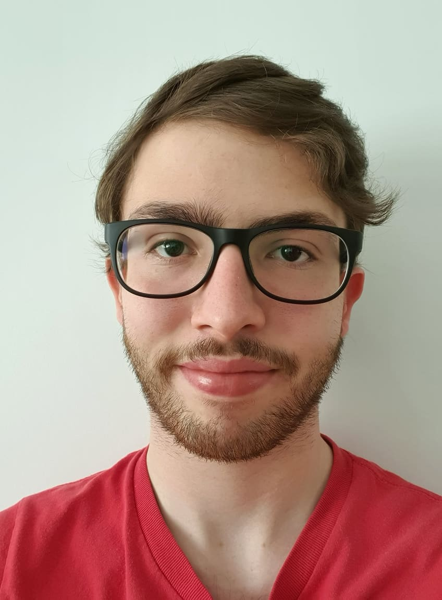
[Rafael Soares]{.speaker-name}
[EuroSys'27]{.speaker-venue}
:::

::: {}
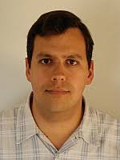
[Luis Pedrosa]{.speaker-name}
:::

::: {}

[André Lopes]{.speaker-name}
[EuroSys'26]{.speaker-venue}
:::
:::

## Dinner

::: {.dinner}
::: {.dinner-info}
[Mezze]{.dinner-name}

[20:00 &middot; R. Ângela Pinto 40D 22/23, 1900-069 Lisboa]{.dinner-meta}

::: {.dinner-note}
[Dinner is not included]{.warn}
Participants pay for their own meal. Pay the fixed dinner cost of
**28,50&euro;** to Rafael Soares by **November 9th**.
Payment information is in the registration form.
:::
:::

::: {.dinner-photo}
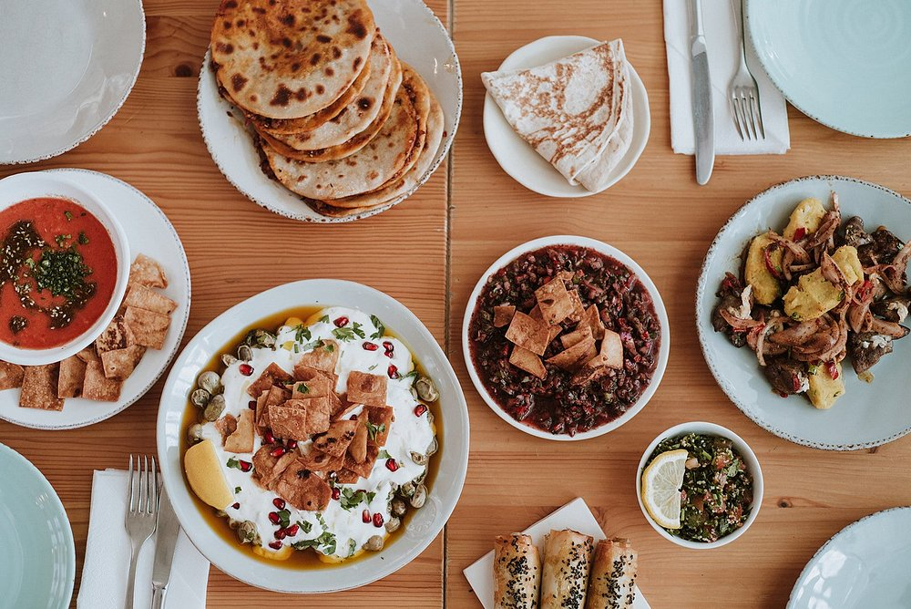
:::
:::

## Website and Registration

::: {.qr-codes}
::: {.qr-code}

[Workshop Website]{.qr-label}
[jrafaelsoares.github.io/GLOGWorkshop]{.qr-url}
:::

::: {.qr-code}

[Registration]{.qr-label}
[forms.gle/bkCkvzZ7rtMaLkrAA]{.qr-url}
:::
:::
